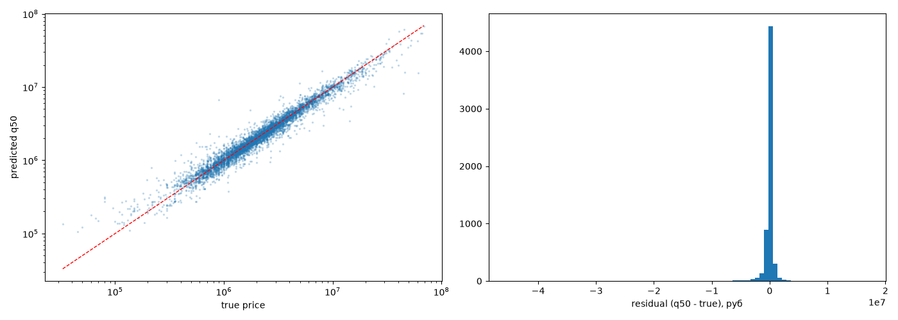
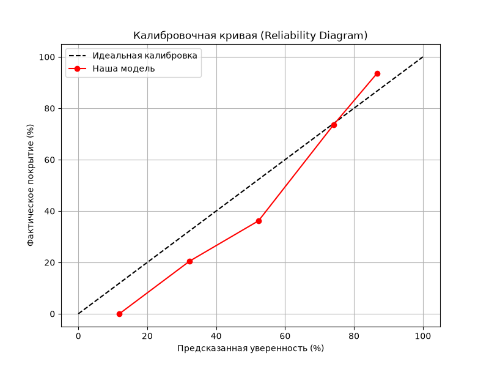

# Car Price ML

ML-модель для оценки стоимости б/у автомобиля по данным объявления Drom.
Возвращает **медианную цену** и **80%-й интервал** — то есть не «точную цену», а честный диапазон.

**Результаты:** R² = 0.959 · MAPE = 12.4% · Coverage = 0.80 · MAE = 400 000 ₽

---

## Быстрый старт

### Docker (рекомендуется)

```cmd
git clone <repo_url>
cd car_price_ml
copy .env.example .env       # впиши свои креды к PostgreSQL
docker compose up
```

API поднимется на `http://localhost:8000`. Swagger — `/docs`.

### Локально

```cmd
python -m venv .venv
.venv\Scripts\activate
pip install -r requirements.txt

copy .env.example .env       # впиши креды
python -m src.etl            # БД → parquet
python -m src.train          # обучение моделей
uvicorn src.api:app --host 127.0.0.1 --port 8000
```

---

## Пример использования

### Через API

```cmd
curl -X POST http://localhost:8000/predict ^
  -H "Content-Type: application/json" ^
  -d "{\"brand\":\"BMW\",\"model\":\"X5\",\"year\":2020,\"mileage_km\":80000,\"power_hp\":340,\"opt_has_panorama\":true,\"opt_has_leather\":true}"
```

Ответ:

```json
{
  "price": 6401028,
  "range_80_low": 6401028,
  "range_80_high": 6588269,
  "range_width_pct": 2.9
}
```

**Что это значит:** медианная цена BMW X5 2020 — 6.40M ₽. С 80% уверенностью — в диапазоне [6.40M, 6.59M].

### Из Python

```python
from src.db import MODELS_DIR
from src.predict import CarPricePredictor

predictor = CarPricePredictor(MODELS_DIR)

car = {
    "brand": "BMW", "model": "X5", "year": 2020,
    "mileage_km": 80000, "power_hp": 340,
    "engine_volume_l": 3.0, "fuel": "бензин",
    "transmission": "АКПП", "drive": "4WD",
    "color": "черный", "owners_count": 2,
    "seller_type": "Частное лицо",
    "seller_description": "Один владелец, не бит",
    "opt_has_panorama": True,
    "opt_has_leather": True,
}

result = predictor.predict(car)
print(f"Медиана:   {result['price']:>12,.0f} ₽")
print(f"Диапазон:  {result['range_80'][0]:>12,.0f} — {result['range_80'][1]:>12,.0f} ₽")
```

---

## Результаты

| Метрика | Значение |
|---|---|
| Датасет | 30 152 объявления, 27 годов, 146 марок |
| R² (log, random split) | **0.959** |
| R² (log, time split) | 0.897 |
| MAE | **400 000 ₽** |
| MAPE | **12.4%** |
| Coverage 80% интервала | **0.80** (калиброван) |
| Ширина 80% интервала | 44% от медианы |

Модель обучена на Москве и МО, вторичный рынок, 2026 год.

```markdown

## Оценка качества модели

График показывает соответствие предсказанных цен (q50) реальным. Модель хорошо улавливает зависимость (R² = 0.959).



---

## Что возвращает модель

Три квантильные модели предсказывают три точки распределения:

| Модель | Что это | Как использовать |
|---|---|---|
| **q10** | Нижняя граница — 10% похожих машин дешевле | Хочешь продать быстро → ставь эту цену |
| **q50** | Медиана — рыночная цена | Хочешь продать в разумный срок |
| **q90** | Верхняя граница — 90% дешевле | Хочешь максимум → ждать придётся |

Для честного покрытия используется **conformal prediction**: интервал расширяется на калибровочную поправку `q_hat`, что гарантирует coverage ≥ 80% на новых данных.

---

## Архитектура

```
┌────────────────────────────────────────────────────────┐
│ Скрейпер (отдельный проект)                            │
│ Drom → PostgreSQL (БД drom, таблица cars)              │
└───────────────────────┬────────────────────────────────┘
                        │
                        ▼
┌────────────────────────────────────────────────────────┐
│ src/etl.py                                             │
│ чтение БД → удаление утечек → разворот JSONB → parquet │
└───────────────────────┬────────────────────────────────┘
                        │
                        ▼
┌────────────────────────────────────────────────────────┐
│ src/features.py — CarFeatureEngineer                   │
│ car_age, mileage_per_year, keyword-флаги, чистка       │
└───────────────────────┬────────────────────────────────┘
                        │
                        ▼
┌────────────────────────────────────────────────────────┐
│ src/train.py                                           │
│ 3× CatBoost Quantile + conformal (q_hat)               │
│ сохранение в models/                                   │
└───────────────────────┬────────────────────────────────┘
                        │
                        ▼
┌────────────────────────────────────────────────────────┐
│ src/predict.py → CarPricePredictor.predict(car)        │
│ src/api.py    → FastAPI: POST /predict                 │
└────────────────────────────────────────────────────────┘
```

---

## API

### `GET /health`

Проверка готовности.

```json
{"status": "ok", "model_loaded": true}
```

### `POST /predict`

Принимает карточку автомобиля, возвращает точку и интервал.

**Обязательные поля:** `brand`, `model`, `year`.

**Опциональные:** все остальные фичи (см. `src/api.py::CarInput`).

**Пример ответа:**
```json
{
  "price": 6401028,
  "range_80_low": 6401028,
  "range_80_high": 6588269,
  "range_width_pct": 2.9
}
```

**Swagger:** `http://localhost:8000/docs` — там же можно тестировать в браузере.

---

## Модель

**Алгоритм:** CatBoost Quantile Regression, 3 модели (`α = 0.1, 0.5, 0.9`).

**Параметры:** `iterations=3000`, `learning_rate=0.05`, `depth=8`, `l2_leaf_reg=3`.

**Таргет:** `log1p(price)` — обязательна (skew raw = 5.31 → skew log = 0.07).

**Фичи (68 шт):**
- **9 числовых:** `car_age`, `mileage_km`, `mileage_per_year`, `power_hp`, `engine_volume_l`, `owners_count`, `photos_count`, `seller_age_years`, `year`
- **48 булевых:** 27 `opt_*` (комплектация), 13 `cond_*` (состояние), 7 `kw_*` (из описания), `mileage_missing`, `is_new_car`
- **11 категориальных:** `brand`, `model`, `generation`, `fuel`, `transmission`, `drive`, `color`, `wheel`, `seller_type`, `city`, `region`

**Важные технические моменты:**

1. **Утечки данных удалены:** `market_price` (corr = 0.99 с таргетом), `deal_type`, `price_discount`, `views`, `json_ld`, `bull_data`.
2. **Quantile crossing** (~4.3% случаев `q10 > q50`) гасится clip'ом в `predict.py`.
3. **`build_features` на одной строке** должна обходить `drop_constant_bools` (иначе все булевы удалятся).
4. **Conformal prediction** — калибровка интервала на отложенных 10% для гарантии coverage ≥ 0.80.

---

## Калибровка уверенности

Модель не просто выдает интервал, но и оценивает вероятность попадания в него. 
Для валидации мы обучили мета-классификатор (CatBoost), который предсказывает вероятность покрытия. 
График ниже показывает, что модель отлично откалибрована (красная линия близка к идеальной):



## Переобучение

Скрейпер добавляет объявления каждый день. Модель устаревает. Рекомендуется переобучать **раз в 1–3 месяца**.

### Ручной запуск

```cmd
python -m src.etl
python -m src.train
```

### Task Scheduler (Windows)

Готовый скрипт `scripts/retrain.bat` — ETL + переобучение + логи в `reports/`.

Настройка:
1. `taskschd.msc` → Create Task
2. Name: `CarPrice_ML_Retrain`
3. Trigger: Monthly, 1-е число, 03:00
4. Action: `scripts\retrain.bat`
5. Start in: `<путь к проекту>`

**Не трогает БД** — только `SELECT`. Скрейпер работает независимо.

---

## Docker

### Запуск

```cmd
docker compose up
```

### Сборка вручную

```cmd
docker build -t car-price-api .
docker run --rm -p 8000:8000 ^
  -e DB_USER=postgres ^
  -e DB_PASS=postgres ^
  -e DB_HOST=host.docker.internal ^
  -e DB_PORT=5432 ^
  -e DB_NAME=drom ^
  car-price-api
```

**Важно:**
- `DB_HOST=host.docker.internal` — адрес хоста из контейнера. Если PostgreSQL не на localhost — используй реальный IP.
- `requirements-docker.txt` — отдельный список (без Jupyter и Windows-only пакетов).
- Образ ~1.3 ГБ, стартует за 3–5 секунд.

### Пересборка после правки кода

```cmd
docker compose down
docker compose build --no-cache
docker compose up
```

**`--no-cache`** обязателен, если менял `src/` — иначе Docker может использовать старый слой.

---

## Структура проекта

```
car_price_ml/
├── .env                      # креды к PostgreSQL (не в git)
├── .env.example              # шаблон
├── .dockerignore
├── Dockerfile
├── docker-compose.yml
├── requirements.txt          # для локальной разработки
├── requirements-docker.txt   # только для контейнера
├── README.md
│
├── src/
│   ├── db.py                 # пути + get_engine()
│   ├── features.py           # CarFeatureEngineer
│   ├── etl.py                # БД → parquet
│   ├── train.py              # обучение моделей
│   ├── predict.py            # CarPricePredictor
│   └── api.py                # FastAPI
│
├── notebooks/                # EDA и эксперименты
│   ├── 01_eda.ipynb
│   ├── 02_baseline.ipynb
│   ├── 03_catboost.ipynb
│   ├── 04_validation.ipynb
│   ├── 05_errors.ipynb
│   ├── 06_features.ipynb
│   ├── 07_quantile.ipynb
│   └── 08_final.ipynb
│
├── scripts/
│   └── retrain.bat           # для Task Scheduler
│
├── data/
│   ├── raw/cars.parquet
│   └── processed/
│
├── models/
│   ├── catboost_final_q10.cbm
│   ├── catboost_final_q50.cbm
│   ├── catboost_final_q90.cbm
│   ├── features.json         # порядок фич
│   ├── cat_features.json
│   └── q_hat.txt             # conformal параметр
│
└── reports/                  # графики, логи
```

---

## Что проверялось и отвергнуто

Честный список экспериментов, которые не вошли в финал:

| Гипотеза | Результат |
|---|---|
| TF-IDF по `seller_description` | ±0.1% MAPE — в пределах шума, не стоит сложности |
| Keyword-флаги (7 шт) | ±0.1% MAPE. Оставлены, потому что не вредят и могут помочь на новых данных |
| `RMSEWithUncertainty` в CatBoost | Ухудшает MAE на 0.5–2% — не подходит |
| Feature interactions вручную | Не помогло, CatBoost находит их сам |

---


## Оценка машин из БД

Скрипт берёт машину из БД и отправляет в API:

```cmd
python clients/predict_from_db.py 575080427       # одна машина
python clients/predict_from_db.py --batch 10      # случайные 10
```


## Ограничения

1. **Не экстраполирует за пределы годов.** Time split (train ≤ 2022, test ≥ 2023): R² падает с 0.959 до 0.897. Деревья не умеют предсказывать для годов, которых не видели.
   *Решение:* переобучать раз в 1–3 месяца.

2. **Новые бренды.** Если марки нет в обучающей выборке — предсказание будет на уровне «среднее по рынку».

3. **Текстовые фичи почти бесполезны** поверх структурных. Keyword-флаги не добавили сигнала.

4. **Ширина интервала 44%** — отражает реальный разброс цен на вторичном рынке. Две одинаковые машины могут быть выставлены с разницей 30% из-за состояния и срочности продажи.

5. **Coverage 0.80 на i.i.d. данных.** Если распределение сильно сдвинется (кризис, новая политика) — coverage может упасть до 0.7.

---

## Troubleshooting

**`NameError: name 'BaseModel' is not defined`** — потеряны импорты в `api.py`. Проверь первые строки.

**`ModuleNotFoundError: No module named 'fastapi'`** — не активирован `.venv`. `\.venv\Scripts\activate`.

**`connection refused` к БД из Docker** — `host.docker.internal` не резолвится. Узнай IP хоста (`ipconfig | findstr IPv4`) и используй его.

**`port 8000 already in use`** — старый uvicorn или контейнер. `taskkill /F /IM python.exe` и `docker compose down`.

**Docker отдаёт старые числа после правки кода** — образ не пересобрался. `docker compose build --no-cache`.

**`TabError: inconsistent use of tabs and spaces`** — открой файл в VS Code → правый нижний угол → «Convert Indentation to Spaces».

---

## Технологии

- **Python 3.12**
- **ML:** catboost, scikit-learn, pandas, numpy
- **API:** FastAPI, uvicorn
- **БД:** PostgreSQL, SQLAlchemy, psycopg2
- **Данные:** pyarrow (parquet)
- **Контейнер:** Docker, docker-compose
- **Конфиг:** python-dotenv

---

## Лицензия

MIT (или укажи свою).

## Автор

Андрей — Debowe979

